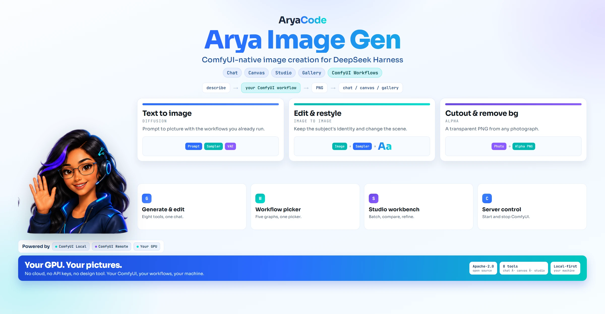
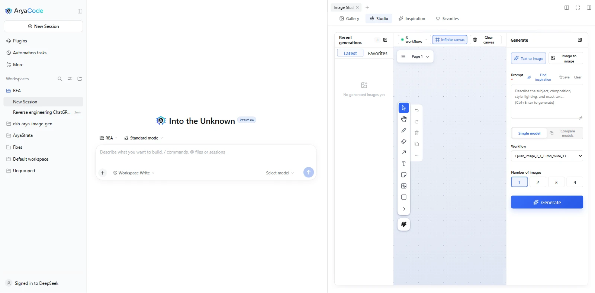

<div align="center">



# Arya Image Gen

### ComfyUI-native image creation for DeepSeek Harness

<p><b>In-chat generation · AI creative canvas · Studio batch creation · workflow comparison · prompt inspiration · gallery · built-in ComfyUI server control</b></p>

<p>
  <a href="https://www.npmjs.com/package/@aryacode/dsh-arya-image-gen"></a>
  <a href="LICENSE"></a>
  
  
</p>

<p>
  <a href="#requirements">Requirements</a> ·
  <a href="#install">Install</a> ·
  <a href="#first-run">First run</a> ·
  <a href="#settings">Settings</a> ·
  <a href="#workflows">Workflows</a> ·
  <a href="#server-control">Server control</a> ·
  <a href="#what-you-get">Surfaces</a> ·
  <a href="#removing-it">Removing it</a> ·
  <a href="#troubleshooting">Troubleshooting</a>
</p>

</div>

**A complete local image workflow for DeepSeek Harness.**

Arya Image Gen gives a DSH web profile the whole image loop in one place: generate and edit images from chat, sketch and iterate on an infinite canvas, batch-create in a Studio workbench, run one prompt across several workflows and compare the results, keep a local gallery, and start, stop or restart the ComfyUI server it talks to. It talks to exactly one thing — a ComfyUI server you run. There is no API key, no cloud provider, no subscription sign-in and no second image backend in this plugin.

It installs into **any DeepSeek Harness web profile**. AryaCode is a rebranded DeepSeek Harness, so the same package drops into an AryaCode build and into an upstream DSH build alike; nothing here is AryaCode-only, and the same install command, the same settings page and the same plugin-market index work on both.

Releases: [GitHub Releases](https://github.com/KonnectSuite/dsh-arya-image-gen/releases) · [`CHANGELOG.md`](CHANGELOG.md) (every version, newest first) · npm package [`@aryacode/dsh-arya-image-gen`](https://www.npmjs.com/package/@aryacode/dsh-arya-image-gen) (0.20.0 and newer; 0.19.2 and older sit under the retired name [`dsh-arya-image-gen`](https://www.npmjs.com/package/dsh-arya-image-gen)).

---

## Requirements

| What you need | Detail |
|---|---|
| A DeepSeek Harness host | Any web profile — AryaCode or an upstream DSH build. The plugin declares `dsh.engines.dsh` `>=0.1.7 <1`, so a host outside that range refuses the layer instead of half-loading it. |
| A ComfyUI server | Reachable **from the DSH host**, not from your browser. Default endpoint `http://127.0.0.1:8188`. No ComfyUI yet? [`docs/install-comfyui.md`](docs/install-comfyui.md) covers the desktop app, the Windows portable builds, `comfy-cli` and a manual install. |
| Enough VRAM for the shipped workflows | The preconfigured Qwen Image 2.1 pack wants a real GPU: 24 GB is comfortable, 8–24 GB makes still images fine, under 8 GB expect out-of-memory on these graphs — use a smaller model or a hosted ComfyUI instead. |
| No credentials | Nothing to authenticate. ComfyUI on a local endpoint needs no key, and this plugin has no credential store, no key field and no sign-in. |
| Node.js, only to build from source | `^22.19.0 \|\| >=24.0.0`, with pnpm `11.7.0`. Installing from npm or from an index needs no Node on your side beyond what DSH itself runs on. |

The plugin opens no listening port of its own. It is a client of the ComfyUI port you point it at (8188 by default), and it registers HTTP routes on the DSH host's own port for its settings health, progress and server-control endpoints.

## Install

### From npm — works on every DeepSeek Harness

The package is `@aryacode/dsh-arya-image-gen`, and that is what npm serves today
(newest 0.20.1):

```bash
dsh plugin --profile web add @aryacode/dsh-arya-image-gen
```

Then restart that profile. The plugin lands as a layer in the profile's config; confirm it with:

```bash
dsh --profile web --dump-config | grep -n "dsh-image-gen"
```

You should see the `@aryacode/dsh-arya-image-gen` layer and its `image-gen` row with the config under it. That line is the proof the row is mounted; if it is missing, the install did not reach the profile you are running.

**0.20.0 renamed the package, and it is a rename, not a rewrite.** Up to 0.19.2
the bundle was published as the unscoped `dsh-arya-image-gen`; from 0.20.0 it is
`@aryacode/dsh-arya-image-gen`. Nothing about the running plugin moved: the
bundle id inside the package stays `dsh-image-gen`, so the settings namespace,
your imported workflows and your gallery are read from the same place either
way. If you installed under the old name, remove it
(`dsh plugin --profile web remove dsh-arya-image-gen`), add the scoped one and
restart. Install one name or the other, never both — two copies of the same
bundle id in one profile is a broken install, not an upgrade. The old name stays
on npm — 0.19.2 and below still install by it — but it is deprecated, and no
0.20.x was ever published under it.

### From the plugin market

- **AryaCode:** open **Plugins → Arya Plugin Market**, find **Arya Image Gen**, install, restart. The market entry is kept in step with npm, so the version you get is the version npm serves. An install made under the pre-rename entry stays put: the catalogue declares `dsh-arya-image-gen` as a former name of this package, so the old install resolves to this one and updates in place.
- **Any DSH host with plugin indexes (0.2.1 and later):** open **Plugins**, enable **Custom plugin indexes** under **Experimental plugins** if your build gates it, go to **Discover → Add index source** and enter
  `https://cdn.jsdelivr.net/gh/KonnectSuite/dsh-arya-image-gen@latest/index.json`
  then install **Arya Image Gen** from the listing and restart.

An index source is a plain JSON file served from this repository, so it works even on a DSH build that has no curated market of its own.

### From a checkout — development

```bash
git clone https://github.com/KonnectSuite/dsh-arya-image-gen.git
cd dsh-arya-image-gen
pnpm install && pnpm build
dsh plugin --profile web add ./dsh-arya-image-gen
```

Inside the DSH app, the same install is **Plugins → Install from file / bundle directory** (`plugin_manager install_bundle`). Copying files into a profile's `node_modules` by hand is not an install: the layer never enters the profile config, and nothing you do that way is reproducible.

## Where it appears

Four places, all after a profile restart:

1. **Plugins page** (left sidebar) → **Installed** → **Arya Image Gen**. Its page holds the ComfyUI settings card: endpoint, workflows, server controls, workspace saving.
2. **Right sidebar → Image Studio.** One tab, four views: **Gallery**, **Studio**, **Inspiration**, **Favorites**; and the **ComfyUI Workbench** with the infinite canvas.
3. **Chat.** The agent gains eight tools: `generate_image`, `generate_images`, `edit_image`, `find_inspiration`, `import_reference_image`, `list_workflows`, `canvas_state`, `view_canvas`.
4. **The preset picker.** A session preset named **Arya Image**, for sessions whose only job is making images.

## First run

1. Start ComfyUI — yourself, or from the plugin's settings card once the endpoint and, for the direct route, the interpreter and folder are set.
2. Open **Plugins → Arya Image Gen**. The endpoint is already `http://127.0.0.1:8188`, and the five shipped workflows are already configured — there is nothing to import before your first image.
3. Press **Check against ComfyUI**. It pre-flights every configured workflow against the running server and names any missing node pack or model file, so a broken graph is a message rather than a failed generation ten minutes later.
4. Ask the agent for an image, or type a prompt in the Studio tab. A finished image reports where it came from:
   ```
   Qwen Image 2.1 - create (adjustable size) · 1024x1024 · seed 1944480124 · queued 0.0s · ran 5.6s · total 5.6s · ComfyUI 0.37.4
   ```
5. Then ask for the same subject at a different size, and for an edit of the result. If both work, the workflow roles and `{{width}}`/`{{height}}` templating are wired up correctly, and you are done configuring.

## Settings

Everything lives on the plugin's own page. Defaults are chosen so that a local ComfyUI on this machine needs no setting at all.

| Setting | Default | What it does |
|---|---|---|
| **Endpoint** | `http://127.0.0.1:8188` | Where prompts are sent. Any ComfyUI the DSH host can reach: loopback, a LAN address, or a reverse-proxy URL including a subpath. |
| **Workflows** | the five shipped graphs | The prompt graphs offered to chat, Studio and comparison. Each row keeps its own JSON, its own preset prompt and its own role. Import API-format JSON; delete rows you do not use. |
| **Active text-to-image / image-to-image workflow** | the first of each role | Which graph a generate or edit call uses when nothing overrides it. The Studio picker and a tool call's `workflow` argument override per call. |
| **Preset prompt** (per workflow row) | empty | Text prepended to every prompt for that workflow, separated by a comma. Style scaffolding that should never be forgotten. |
| **Request timeout** | 300000 ms (5 min) | How long one run may take before it is reported as failed. 1000–3600000 ms. Raise it for slow GPUs and big graphs. |
| **Request headers** | empty | A JSON object of headers sent on every request — upload, prompt, history, image. This is where a reverse proxy's `Authorization` token goes. Leave empty for a local server. |
| **Launch method** | `auto` | How **Start** launches a local server: `auto` prefers a Windows scheduled task named `ComfyUI` and falls back to the direct route; `scheduled-task` drives `schtasks`; `process` runs `main.py` itself. The card tells you which path it picked and what state the task is in. |
| **Scheduled task name** | `ComfyUI` | Which task **Start** / **Stop** drive in the two task routes. |
| **Python executable** | empty | The interpreter for the direct route. Only needed when it is not on `PATH`, or when ComfyUI has its own venv. |
| **ComfyUI directory** | empty | The folder holding `main.py`, for the direct route. |
| **Extra arguments** | empty | Appended to the direct route's command line, e.g. `--lowvram --port 8189`. |
| **Start automatically** | off | Bring the server up when the plugin loads if nothing is answering on the endpoint. Off, because a server you start yourself should stay yours. |
| **Arya Image preset** | on | Registers the **Arya Image** session preset. Turn it off to keep the image tools without the preset. |
| **Save generated images to the workspace** | on | Writes every finished image into the workspace as well as the gallery, so files are on disk for other tools to read. |
| **Workspace folder** | `dsh-arya-image-gen` | The subfolder those files land in, under the session workspace. Changing it does not move existing files. |

The card also shows a live status chip: the ComfyUI version, GPU and available VRAM when the server answers, and a launch hint such as `Auto: using scheduled task "ComfyUI" (Running).`

## Workflows

A ComfyUI workflow is this plugin's "model". A fresh install arrives with five already configured, so the first image needs no setup:

| Workflow | Role | What it is for |
|---|---|---|
| `Qwen Image 2.1 - compose (any number of references)` | image to image | Build one image out of several reference images at once. |
| `Qwen Image 2.1 - create (adjustable size)` | text to image | Generate from a prompt, at whatever size the call asks for. |
| `Qwen Image 2.1 - cutout (RGBA)` | image to image | Cut a subject out and return it on transparency. |
| `Qwen Image 2.1 - edit` | image to image | Change one image while keeping the subject. |
| `Qwen Image 2.1 - remove background` | image to image | Drop the background. |

The JSON files are in [`docs/workflows/`](docs/workflows/), and the same pack ships as [`arya-qwen-image-pack.zip`](docs/workflows/arya-qwen-image-pack.zip). Import them as they are, or import any API-format graph of your own.

Placeholders are the whole contract:

- `{{prompt}}` — required, the prompt text.
- `{{seed}}` — a 32-bit integer seed.
- `{{image}}` — at most one, in a `LoadImage` input. This is what makes a workflow edit-capable.
- `{{width}}`, `{{height}}` (64–8192), `{{steps}}` (1–150), `{{cfg}}` (0–30) — declare them and every call may set them; a numeric placeholder must be the whole field value.
- `{{resolution}}` — derived, not passed: the canvas long side rounded to 32, for graphs that want a square-ish size.

Workflows are grouped by role — **Text to image** and **Image to image** — detected from the JSON on import and overridable per row. Each group remembers its own active workflow, so an edit uses the edit graph without you switching anything.

Export from ComfyUI with **Save (API Format)**; UI-format exports are not supported. One workflow that templates its size beats one JSON per size. The full placeholder table, the role rules, the error messages and the pack tests are in [`docs/comfyui-workflows.md`](docs/comfyui-workflows.md).

## Server control

The settings card owns a local ComfyUI it did not create, and never touches one it does not own:

- **Start** follows the launch method. `auto` runs a Windows scheduled task named `ComfyUI` when that task exists and otherwise falls back to the direct route; `scheduled-task` runs `schtasks /run`; `process` launches `main.py` with the configured interpreter and extra arguments.
- **Stop** targets only a Python process whose command line runs ComfyUI's `main.py` on the configured port. Another listener on that port — a different app, a container, a proxy — is never killed.
- **Restart** stops and starts in one action. A process that holds the port without answering is cleared first, and a task stuck in `Running` is ended before the next run.
- **Auto-start** launches the server when the plugin loads, if the endpoint is not already answering.
- Against a **remote** endpoint the Start / Stop / Restart buttons are hidden: they would act on the wrong machine. The card only probes `/system_stats`.

### Live progress

The Studio panel streams a running job from ComfyUI's `/ws` socket: queue position and queue wait, the current node label with its step counter (`SamplerCustomAdvanced 3/8`), elapsed time about once a second, a preview thumbnail when the server emits latent preview frames, and **Cancel**, which removes the prompt from ComfyUI's queue instead of leaving it running.

Progress is advisory. If a proxy blocks the WebSocket upgrade — header-authenticated proxies often do — generation still works and the panel falls back to an indeterminate bar with elapsed time. Live progress inside the chat transcript is not available: DSH renders fixed conversation node kinds, so the running view lives in the Studio panel while the chat card stays a result card.

### Remote ComfyUI

A server on another machine works with nothing running locally:

1. On the ComfyUI machine, listen beyond loopback: `python main.py --listen 0.0.0.0 --port 8188`. ComfyUI binds `127.0.0.1` by default, which is the usual reason a LAN address refuses.
2. Set the endpoint: LAN `http://192.168.1.20:8188`, or a reverse proxy `https://comfy.example.com/` or `https://example.com/comfy/` — API paths resolve relative to it.
3. If the proxy requires auth, put the header in **Request headers**, e.g. `{"Authorization": "Bearer <token>"}`.
4. Leave the local server fields empty; they do not apply.

Do not expose ComfyUI to the open internet: it has no authentication. Prefer a VPN (Tailscale, WireGuard), an SSH tunnel, or a reverse proxy that enforces auth and TLS. Self-signed certificates are rejected by the DSH host — use a trusted certificate, or plain HTTP inside a VPN.

## What you get



- **Chat generation.** `generate_image`, `generate_images` (a batch in one call) and `edit_image`, with automatic workspace saving and a provenance line on every result.
- **AI creative canvas.** A tldraw infinite canvas where a sketch, a text note or a pasted image becomes model-readable context. `canvas_state` says what is on it, `view_canvas` shows the current selection, `edit_image` edits that selection.
- **Studio workbench.** Prompt, workflow picker, reference uploads, batch count, live progress and a recent-generation rail.
- **Workflow comparison.** One prompt across two or more workflows, results side by side — the fastest way to decide which graph to keep.
- **Prompt inspiration.** A bundled library of copy-ready prompts, plus a cover-prompt builder that composes one from parts.
- **Gallery.** A local IndexedDB gallery with favorites, save-to-workspace and delete. Nothing is uploaded anywhere.

### The Arya Image preset

A session preset for image work, registered when the `Arya Image preset` setting is on. It mounts the eight image tools plus one small working set — `read`, `write`, `edit`, `glob`, `grep`, `read_image`, `pwsh` or `bash`, the job tools, `web_search`, `web_fetch`, `ask_user_question`, `present`, `working_directory` — and a last row, `@aryacode/dsh-arya-image-gen/agent-toolset`, masks every other globally registered tool, so other bundles, MCP servers and computer use never reach that prompt. Goals, skills, plan mode, scheduling, `todo_write` and delegation stay out: an image session does not use them, and every tool schema is paid for on every request.

The mask is fail-open: names the host does not register are dropped from the filter, and if the restriction is refused outright the session starts exactly as it would have without the preset. Set `agentPreset: false` to register the tools without the preset.

### Reference images from the web

When a request names something that already exists — a product, a landmark, a vehicle, a uniform, a brand mark — the agent can fetch a photograph of the actual subject and edit from it, instead of guessing at details it cannot know: `web_search` → `web_fetch` → `import_reference_image` → `edit_image(source_path=…)`. `import_reference_image` downloads one public image into the session workspace, refuses anything that is not really a PNG, JPEG or WebP, refuses private and loopback addresses, and caps the download at 16 MB. Full rules, source-quality guidance and the honesty rules are in [`docs/reference-images.md`](docs/reference-images.md).

## Removing it

```bash
dsh plugin --profile web remove dsh-arya-image-gen
```

Use the name you installed: `dsh-arya-image-gen` for 0.19.2 and older,
`@aryacode/dsh-arya-image-gen` from 0.20.0. Restart the profile. That
unregisters the tools, the settings card, the Studio tab and the preset, and
removes the layer from the profile config. Then, only if you want the data gone:

- the workspace subfolder of generated images (`dsh-arya-image-gen/` by default),
- the browser gallery, which lives in the DSH web profile's IndexedDB and is cleared by clearing that profile's site data,
- the plugin's cache and log directories under the DSH home directory.

Removing the plugin never touches your ComfyUI installation, its models, or a scheduled task it launched.

## Troubleshooting

| What you see | What it means, and what to do |
|---|---|
| `ComfyUI connection refused` / a connection error on every call | Nothing is answering on the endpoint. Press **Start** on the plugin page, or start ComfyUI yourself and confirm the endpoint. For a LAN address, check that ComfyUI was started with `--listen` — the default binds loopback only, so the address you typed is right and the server simply is not listening on it. |
| A workflow fails with a missing node class | The graph needs a custom node pack this ComfyUI does not have. **Check against ComfyUI** names the missing classes for every configured workflow; install the pack, or delete the workflow row. |
| A workflow fails with a missing model file | A checkpoint or LoRA is not in the model folders the server scans. [`docs/install-comfyui.md`](docs/install-comfyui.md) lists the files the shipped pack needs and where they go. |
| Generation stalls, then the run dies | Usually VRAM. Lower the size, lower `--steps`, or add `--lowvram` to **Extra arguments**. A run that dies at the same node every time is a graph problem, not a memory one. |
| Progress stops updating mid-run, but the image still arrives | The proxy dropped the WebSocket upgrade. Nothing is broken: the panel falls back to elapsed time. Add `proxy_set_header Upgrade/Connection` at the proxy if you want live progress back. |
| Images come out cropped or off-proportion at odd sizes | The active workflow has fixed `EmptyLatentImage` dimensions. Template it with `{{width}}`/`{{height}}`, or pick the `create (adjustable size)` workflow. |
| The plugin is installed but nothing appears in chat or the sidebar | The layer is not in the profile you are running. Check `dsh --profile <profile> --dump-config` for this plugin's layer (`dsh-arya-image-gen`, or `@aryacode/dsh-arya-image-gen` from 0.20.0) and its `image-gen` row, then restart that profile — a running profile does not pick up a new layer on its own. |
| `ERR_PNPM_GIT_DEP_PREPARE_NOT_ALLOWED` while installing from a Git or directory spec | pnpm will not run a dependency's `prepare` build script without your say-so. Add the exact package key pnpm prints to the profile's `pnpm-workspace.yaml` allow list, then retry — installing from npm needs no allowance. |
| The market listing does not show the newest version | The index is a static file; allow the CDN a few minutes, or install by package name. On AryaCode the catalogue reconciles against npm on its own. |
| The **Arya Image** preset is missing from the picker | The `Arya Image preset` setting is off, or the preset was edited in the Web editor and replaced its row list. Re-enable the setting and restart; an edited preset is not merged into by an update. |

## Development

```bash
pnpm install
pnpm typecheck     # tsc --noEmit
pnpm test          # vitest run
pnpm build         # sync the generated workflow pack, then tsc + tsdown
pnpm pack:check    # npm pack dry run
pnpm test:package  # install the real tarball in a temp dir and boot it against DSH
```

`src/generated/default-workflows.ts` is generated from `docs/workflows/*.json` by `pnpm sync:workflows`; `tests/default-workflows.spec.ts` fails when the two drift, so edit the JSON and re-sync rather than editing the generated file. CI runs typecheck, test, build, pack:check and test:package on Ubuntu and Windows against Node 24 with pnpm 11.7.0.

## Releasing

Publishing does not happen from CI. A version reaches a user when the maintainer runs, from the sibling `dsh-arya-market` checkout:

```bash
node scripts/release-plugin.mjs --dir ../dsh-arya-image-gen
```

That publishes npm, refreshes this repository's `index.json` from the registry packument, commits and tags, and opens the GitHub Release from the matching `CHANGELOG.md` section. The four conditions it proves: npm serves the version, the market catalogue lists it, the catalogue's `releases[0].sha256` is the hash npm serves, and `check-catalogue-parity.mjs` exits 0. `.github/workflows/release.yml` only turns a tag into a GitHub Release whose body is that version's changelog section; it publishes nothing.

## FAQ

**Does this work outside AryaCode?** Yes. It is a DeepSeek Harness plugin: same package, same `dsh plugin … add` command, same settings page on any DSH web profile within the declared host range. AryaCode is one host that takes it; an upstream DSH build is another.

**Can I add another image provider?** No. ComfyUI is the only back end this plugin talks to, by design — there is no cloud provider to enable and no key to fill in. If a hosted image API is what you need, this is the wrong plugin; [`NOTICE`](NOTICE) names the project that took a broader approach.

**Does it store API keys?** No. There is no credential store and no key field: ComfyUI needs none. The only secret the plugin can hold is a proxy token you choose to type into **Request headers**.

**Why is the package named `@aryacode/dsh-arya-image-gen` now?** It was published unscoped as `dsh-arya-image-gen` up to 0.19.2. From 0.20.0 it carries the `@aryacode` scope, which is where the other Arya DSH plugins live, so the family installs and updates under one name. The old name stays on npm and is never pulled down, and both names refer to the same bundle id — your settings and gallery survive the switch.

**Where do the shipped workflow models come from?** The Qwen Image 2.1 graphs expect the Qwen Image 2.1 model files; [`docs/install-comfyui.md`](docs/install-comfyui.md) names each file and the folder it belongs in. Swap in your own workflows whenever you like — the plugin has no opinion about which graph you import.

## Licence and provenance

Apache License 2.0 — see [`LICENSE`](LICENSE).

Arya Image Gen is a derivative of [`shanliuling/dsh-image-gen`](https://github.com/shanliuling/dsh-image-gen) (Apache-2.0). [`NOTICE`](NOTICE) records what was removed and what was added in this fork: the cloud providers and their credential UI are gone, the ComfyUI server lifecycle and the workflow-role model are not upstream. The original Apache-2.0 text is preserved.
