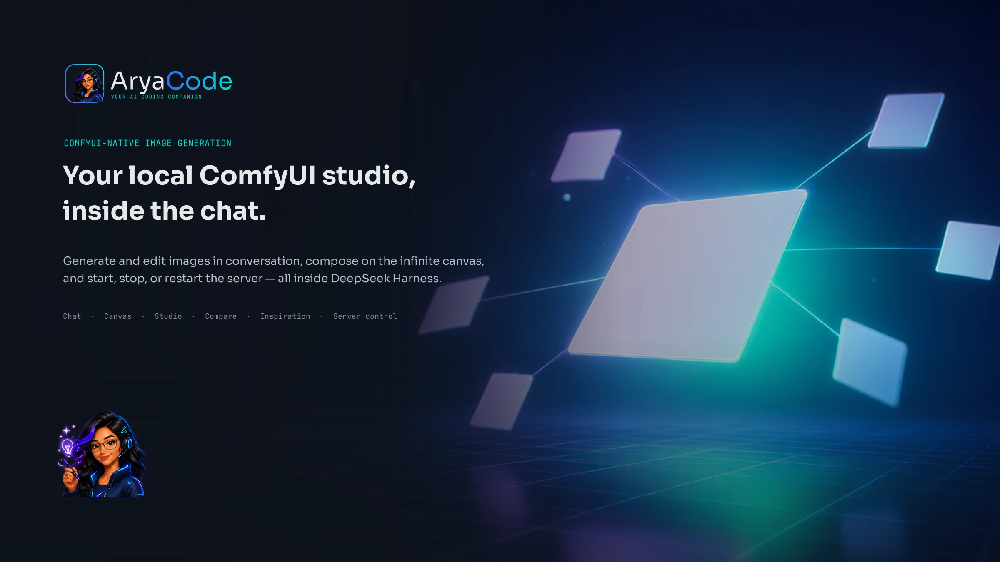
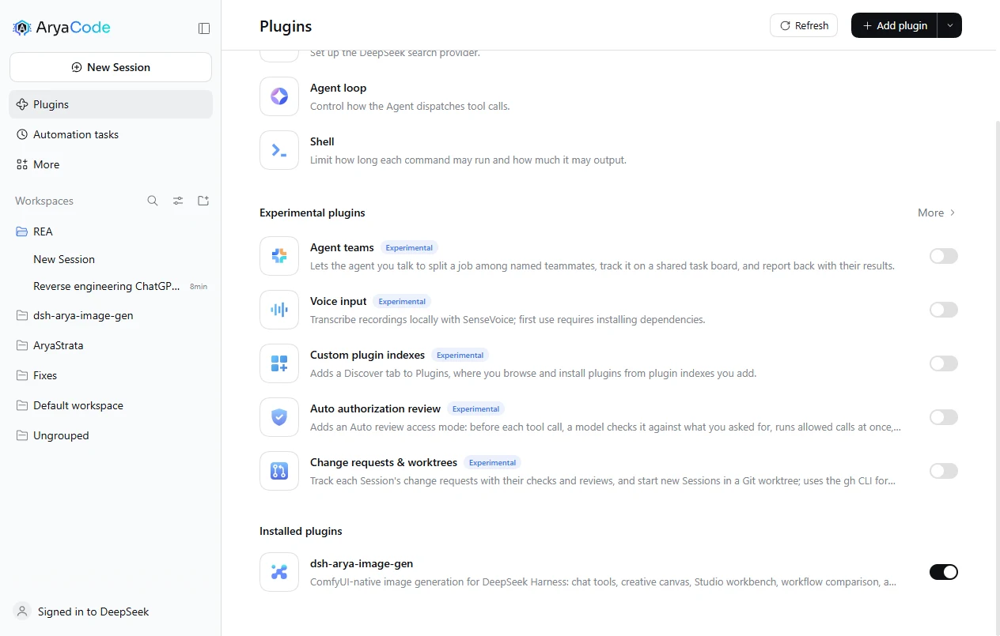
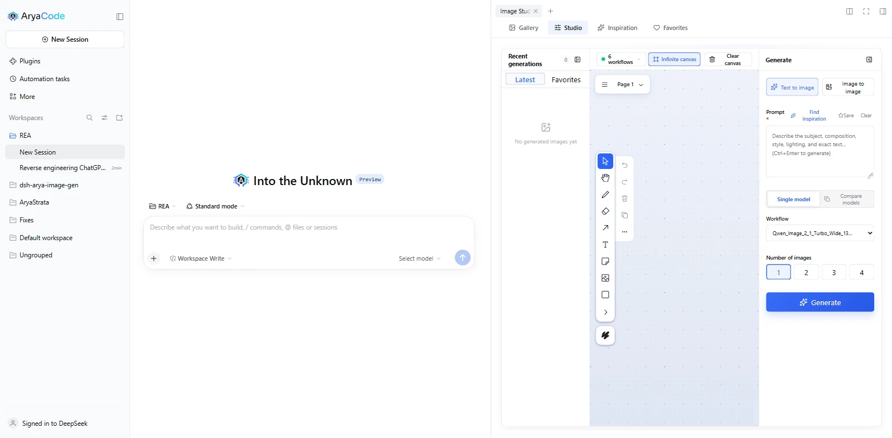
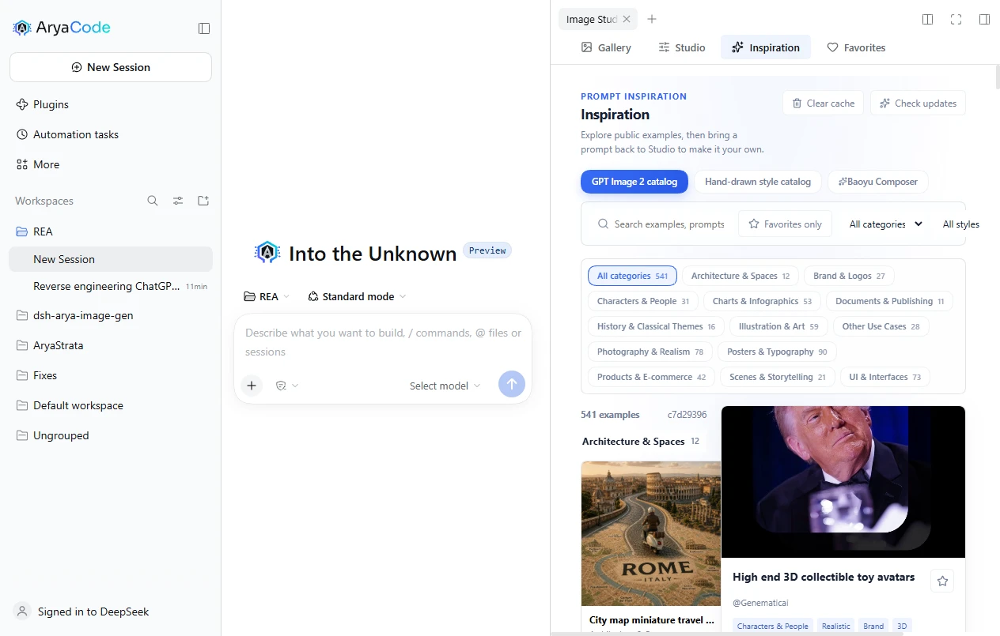

<div align="center">



# Arya Image Gen

### ComfyUI-native image creation for DeepSeek Harness

<p><b>In-chat generation · AI creative canvas · Studio batch creation · Workflow comparison · Prompt inspiration · Gallery management · Built-in ComfyUI server control</b></p>

<p>
  <a href="LICENSE"></a>
  
</p>

<p>
  <a href="#quick-start">Quick Start</a> ·
  <a href="#workflows">Workflows</a> ·
  <a href="#server-control">Server Control</a> ·
  <a href="#features">Features</a> ·
  <a href="#faq">FAQ</a>
</p>

</div>

**A complete local image workflow for DeepSeek Harness.**

`dsh-arya-image-gen` is an AryaCode fork of [dsh-image-gen](https://github.com/shanliuling/dsh-image-gen), reduced to a single provider: **your local ComfyUI server**. Everything that used cloud APIs, API keys, subscription sign-ins, and multi-provider comparison has been removed. What remains is a tighter plugin that talks only to ComfyUI and can start, stop, and restart the server it uses.

It keeps the full creative loop: generate and edit images in chat, sketch and iterate on the infinite canvas, batch-generate in the Studio workbench, compare workflows side by side, and browse a bundled prompt inspiration library.

## Quick Start

1. Run ComfyUI locally (default endpoint `http://127.0.0.1:8188`). You can start it from the plugin itself once configured.
2. Install the plugin in your DSH profile:

   ```bash
   dsh plugin --profile web add dsh-arya-image-gen
   ```

3. Open **Settings → Plugins → Arya Image Gen**:
   - Set the ComfyUI **Endpoint**.
   - Import one or more **API-format workflow JSON** files exported from ComfyUI.
   - Mark the active workflow.
4. Ask the agent to generate something, or open the Studio tab.



## Workflows

ComfyUI workflows are the "models" of this plugin. Each imported JSON becomes a selectable option in the chat pill, the Studio model picker, and the comparison view.

- Put `{{prompt}}` in the prompt input of the workflow. It is required.
- Put `{{seed}}` where a random seed should be injected.
- For image-to-image, put `{{image}}` exactly once in the LoadImage image input. Such workflows appear as edit-capable; generation-only workflows cannot run `edit_image`.
- A workflow preset prompt is prepended to every user prompt for that workflow, separated by a comma.

Export from ComfyUI with **Save (API Format)**. UI-format workflows are not supported.

## Server Control

The settings card can start, stop, and restart the local ComfyUI process:

- **Start** launches `main.py` with the configured Python executable and extra arguments, then waits for `/system_stats`.
- **Stop** targets only Python processes whose command line runs ComfyUI's `main.py` on the configured port. Other listeners on that port are never touched.
- **Restart** stops and starts in one action.
- **Auto-start** launches the server when the plugin loads if it is not already up.

The live status chip shows the ComfyUI version, GPU, and available VRAM when the server is running.

## Features

- **Chat generation**: `generate_image`, `generate_images`, and `edit_image` tools with automatic workspace saving.
- **AI creative canvas**: a tldraw infinite canvas where sketches, text, and pasted images become model-readable context; selections can be edited directly.
- **Studio workbench**: prompt, workflow picker, reference uploads, batch counts, and a recent-generation rail.
- **Workflow comparison**: run one prompt across two or more imported workflows.
- **Prompt inspiration**: a bundled library with copy-ready prompts and a composable cover-prompt builder.
- **Gallery**: local IndexedDB gallery with favorites, saving to workspace, and deletion.





## Requirements

- DeepSeek Harness with the web profile.
- A running ComfyUI instance reachable from the DSH host (local or remote).
- Node.js `^22.19.0 || >=24.0.0` for development.

## Development

```bash
pnpm install
pnpm typecheck
pnpm test
pnpm build
```

## FAQ

**Why does generation fail with a connection error?**
The ComfyUI server is not running or not reachable. Use the server controls in Settings, or start ComfyUI manually and confirm the endpoint.

**Can I add another cloud provider?**
No. This fork deliberately supports ComfyUI only. Use the upstream project if you need cloud providers.

**Does it store API keys?**
No. ComfyUI needs none, and the credential UI was removed with the cloud providers.

## License

Apache License 2.0. This project is a derivative of [shanliuling/dsh-image-gen](https://github.com/shanliuling/dsh-image-gen) (Apache-2.0); see `LICENSE` and `NOTICE` for attribution.
