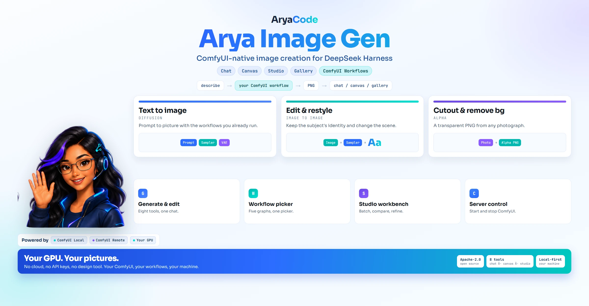

<div align="center">



# Arya Image Gen

### ComfyUI-native image creation for DeepSeek Harness

<p><b>In-chat generation · AI creative canvas · Studio batch creation · Workflow comparison · Prompt inspiration · Gallery management · Built-in ComfyUI server control</b></p>

<p>
  <a href="LICENSE"></a>
  
</p>

<p>
  <a href="#quick-start">Quick Start</a> ·
  <a href="#workflows">Workflows</a> ·
  <a href="#server-control">Server Control</a> ·
  <a href="#features">Features</a> ·
  <a href="#faq">FAQ</a>
</p>

</div>

**A complete local image workflow for DeepSeek Harness.**

`dsh-arya-image-gen` is an AryaCode fork of [dsh-image-gen](https://github.com/shanliuling/dsh-image-gen), reduced to a single provider: **your local ComfyUI server**. Everything that used cloud APIs, API keys, subscription sign-ins, and multi-provider comparison has been removed. What remains is a tighter plugin that talks only to ComfyUI and can start, stop, and restart the server it uses.

It keeps the full creative loop: generate and edit images in chat, sketch and iterate on the infinite canvas, batch-generate in the Studio workbench, compare workflows side by side, and browse a bundled prompt inspiration library.

## Quick Start

1. Run ComfyUI locally (default endpoint `http://127.0.0.1:8188`). You can start it from the plugin itself once configured.
2. Install the plugin in your DSH profile:

   ```bash
   dsh plugin --profile web add dsh-arya-image-gen
   ```

3. Open **Settings → Plugins → Arya Image Gen**:
   - Set the ComfyUI **Endpoint**.
   - Import one or more **API-format workflow JSON** files exported from ComfyUI.
   - Mark the active workflow.
4. Ask the agent to generate something, or open the Studio tab.


### Install from the market

DSH ships no official plugin market, so the AryaCode market is a plugin index you add once:

1. Open **Plugins** and enable **Custom plugin indexes** under **Experimental plugins**.
2. In **Discover**, choose **Add index source** and enter:
   `https://raw.githubusercontent.com/KonnectSuite/dsh-arya-image-gen/main/docs/market/index.json`
3. Install **Arya Image Gen** from the listing.


## Workflows

ComfyUI workflows are the "models" of this plugin. A fresh install already arrives with the five shipped workflows configured (compose from any number of references, text-to-image with adjustable size, cutout, edit, background removal), so there is nothing to import before the first image. Each imported JSON becomes a selectable option in the Studio model picker, the comparison view, and the chat tools.

Workflows are grouped by role: **Text to image** and **Image to image**, detected from the JSON and overridable per workflow. Each group remembers its own active workflow, so `edit_image` uses the edit graph without you switching anything.

- Put `{{prompt}}` in the prompt input of the workflow. It is required.
- Put `{{seed}}` where a random seed should be injected.
- For image-to-image, put `{{image}}` exactly once in the LoadImage image input; that is what makes a workflow edit-capable.
- Put `{{width}}`, `{{height}}`, `{{steps}}` or `{{cfg}}` on numeric inputs to let a call adjust them — one templated workflow then covers every size instead of one JSON per size.
- A workflow preset prompt is prepended to every user prompt for that workflow, separated by a comma.

Export from ComfyUI with **Save (API Format)**. UI-format workflows are not supported.

Five ready-made API workflows ship with the plugin — Qwen Image 2.1 compose (any number of references), create (with adjustable size), cutout, edit and background removal — in [`docs/workflows/`](docs/workflows/); the first four are also in [`arya-qwen-image-pack.zip`](docs/workflows/arya-qwen-image-pack.zip). Import them as-is.

**Check against ComfyUI** in the Workflows card pre-flights every configured workflow against the running server and reports missing node packs or model files by name.

Placeholders, roles, size presets, the ready-made pack and the one-workflow-per-size conversion are documented in [docs/comfyui-workflows.md](docs/comfyui-workflows.md).

## Server Control

The settings card can start, stop, and restart the local ComfyUI:

- **Launch method — Automatic** (default) needs no paths: if a Windows scheduled task named `ComfyUI` exists, Start runs it and Stop ends it; otherwise the plugin falls back to the Python route. The card says which path it picked and what state the task is in.
- **Scheduled task** — Start is `schtasks /run`, Stop is `schtasks /end` plus a port backstop, so a tray/service install that already knows how to launch ComfyUI keeps owning that knowledge.
- **Python process (main.py)** — Start launches `main.py` with the configured interpreter and extra arguments; this is the only route that asks for paths.
- **Stop** targets only Python processes whose command line runs ComfyUI's `main.py` on the configured port. Other listeners on that port are never touched.
- **Restart** stops and starts in one action; a stale process that holds the port without answering is cleared first, and a task stuck in `Running` is ended before the next run.
- **Auto-start** launches the server when the plugin loads if it is not already up.

The live status chip shows the ComfyUI version, GPU, and available VRAM when the server is running, and the launch hint reads like `Auto: using scheduled task "ComfyUI" (Running).`

### Generation details and live progress

Every finished image reports provenance, for the model and the UI alike:

```
Qwen_Image_2_1_Turbo_Square_1024 · 1024x1024 · seed 1944480124 · queued 0.0s · ran 5.6s · total 5.6s · ComfyUI 0.37.4
```

The Studio panel streams progress for a running job:

- **Queue** position and queue wait, measured from `/queue`.
- **Node** label from the workflow (`SamplerCustomAdvanced`, `TextEncodeQwenImage21`, ...) and its step counter (`3/8`).
- **Elapsed** time, updated about once a second.
- **Preview thumbnail** when ComfyUI emits latent preview frames. Many installations do not enable them; the panel simply shows progress without a thumbnail.
- **Cancel** now removes the prompt from ComfyUI's queue instead of leaving it running.

Progress comes from ComfyUI's `/ws` socket and is advisory: if a proxy blocks the WebSocket upgrade (header-authenticated proxies often do), generation still works and the panel falls back to an indeterminate bar with elapsed time. Inline progress inside the chat transcript is not available: DSH's Chat target renders fixed conversation node kinds, so the live view lives in the Studio panel while the chat card stays a result card.

### Remote ComfyUI

A server on another machine works with nothing running locally:

1. On the ComfyUI machine, listen beyond loopback and open the port:
   ```bash
   python main.py --listen 0.0.0.0 --port 8188
   ```
   Default ComfyUI binds `127.0.0.1` only, which is the usual reason a LAN address refuses connections.
2. In **Settings → Arya Image Gen → Connection**, set the endpoint:
   - LAN: `http://192.168.1.20:8188`
   - Reverse proxy: `https://comfy.example.com/` or a subpath such as `https://example.com/comfy/` (API paths are resolved relative to it)
3. If the proxy requires auth, put it in **Request headers**, for example
   `{"Authorization": "Bearer <token>"}` or `{"Authorization": "Basic <base64>"}`. Headers are sent on every upload, prompt, history, and image request.
4. Leave the local **Server** fields empty: for a remote endpoint the card only probes `/system_stats`, and Start / Stop / Restart are hidden because they act on the server's machine.

Security: do not expose ComfyUI to the internet without authentication. Prefer a VPN (Tailscale/WireGuard), an SSH tunnel, or a reverse proxy that enforces auth and TLS. Self-signed certificates are rejected by the DSH host; use a trusted certificate or plain HTTP inside a VPN.

## Features

- **Chat generation**: `generate_image`, `generate_images`, and `edit_image` tools with automatic workspace saving.
- **Reference images from the web**: when a request names something real, the agent finds the actual photograph, imports it with `import_reference_image`, and edits from it instead of guessing at the details.
- **AI creative canvas**: a tldraw infinite canvas where sketches, text, and pasted images become model-readable context; selections can be edited directly.
- **Studio workbench**: prompt, workflow picker, reference uploads, batch counts, and a recent-generation rail.
- **Workflow comparison**: run one prompt across two or more imported workflows.
- **Prompt inspiration**: a bundled library with copy-ready prompts and a composable cover-prompt builder.
- **Gallery**: local IndexedDB gallery with favorites, saving to workspace, and deletion.


## Presets

This bundle also registers an agent preset, **Arya Image**, for sessions whose only job is making images. Pick it in the preset picker when you start a session.

- Mounts the eight image tools plus one small working set: `read`, `write`, `edit`, `glob`, `grep`, `read_image`, `pwsh` (or `bash`), the job tools, `web_search`, `web_fetch`, `ask_user_question`, `present` and `working_directory`.
- Uses two mechanisms, because each alone is not enough: its own rows mount those tools, and a last row (`dsh-arya-image-gen/agent-toolset`) masks every other globally registered tool, so other bundles, MCP servers and computer use never reach the prompt.
- Deliberately leaves out goals, skills and the `skill` tool, plan mode, scheduling, `todo_write`, delegation (`subagent`, `subagent_fork`, `workflow`) and the host plugin-manager and plugin-market rows. An image session does not use them, and every tool schema is paid for on every request.
- Compaction is the harness default: `compaction-basic`, `/compact` and the tool-result pruner. When billion-context owns compaction — its `biliBasicCompactionPolicy` service is up and its ownership verdict is `active` — those two summary rows are registered disabled and the pruner stays; without billion-context, or when its verdict never arrives, the stock rows stay exactly as they are.

Set `agentPreset: false` in the plugin configuration to stop the preset from being registered.

Three things worth knowing. A preset selects the rows its session mounts, and the mask removes the rest from that session's tool list; tools it does not mount still exist on the host, they are just not offered to that session. The mask is fail-open: names the host does not register are dropped from the filter, and if the host refuses the restriction outright, the session starts exactly as it would have without it. And editing a preset in the Web editor replaces its whole row list, so a later plugin update will not merge into an edited copy.

## Reference images

A prompt can describe a thing; it cannot reproduce one. When the request names something that already exists — a product, a landmark, a vehicle, a brand mark, a uniform, a public figure — the agent can fetch a photograph of the actual subject and edit from it, which is how the details it cannot know arrive intact.

The loop is `web_search` → `web_fetch` (to find the image URL) → `import_reference_image` → `edit_image(source_path=…)`. `import_reference_image` is the only new part: it downloads one public image into the session workspace, refuses anything that is not really a PNG, JPEG or WebP, refuses private and loopback addresses, and caps the download at 16 MB.

```
import_reference_image(url="https://example.org/press/eiffel-tower.jpg", name="eiffel-tower")
→ { path: "…/references/eiffel-tower.png", mediaType: "image/png", width: 2400, height: 1600, … }

edit_image(source_path="…/references/eiffel-tower.png",
           prompt="Keep the tower's proportions, tier spacing and arch shape; dusk, warm interior lights, no people.")
```

Full workflow, source quality rules, limits and the honesty rules: [docs/reference-images.md](docs/reference-images.md). The same guidance ships as the `arya-image-references` skill, and a condensed version sits in the **Arya Image** preset's persona so it works without the skill tool.

## Requirements

- DeepSeek Harness with the web profile.
- A running ComfyUI instance reachable from the DSH host (local or remote). No install yet? See **[docs/install-comfyui.md](docs/install-comfyui.md)** for the desktop app, portable build, comfy-cli and manual routes.
- Node.js `^22.19.0 || >=24.0.0` for development.

## Development

```bash
pnpm install
pnpm typecheck
pnpm test
pnpm build
```

## Publishing to the Arya market

The AryaCode app reads its catalog from
`https://raw.githubusercontent.com/KonnectSuite/dsh-arya-market/catalog/data/arya-plugins.json`.
Add a release there and it appears in the market without an app update.

`.github/workflows/arya-catalog.yml` automates the catalog write:

- runs on a published GitHub release, on manual dispatch, and daily as a safety net;
- downloads the npm tarball, computes its SHA-256, and upserts the entry
  (`scripts/upsert-arya-catalog.mjs`), keeping older releases for version restore;
- refuses to replace an existing version with different bytes.

One-time setup: create a token with `contents: write` on `KonnectSuite/dsh-arya-market`
and save it as the `ARYA_CATALOG_TOKEN` secret in this repository.

Run it locally to preview an entry without writing:

```bash
node scripts/upsert-arya-catalog.mjs --market ../dsh-arya-market --version 0.11.1 --dry-run
```

## FAQ

**Why does generation fail with a connection error?**
The ComfyUI server is not running or not reachable. Use the server controls in Settings, or start ComfyUI manually and confirm the endpoint.

**Can I add another cloud provider?**
No. This fork deliberately supports ComfyUI only. Use the upstream project if you need cloud providers.

**Does it store API keys?**
No. ComfyUI needs none, and the credential UI was removed with the cloud providers.

## License

Apache License 2.0. This project is a derivative of [shanliuling/dsh-image-gen](https://github.com/shanliuling/dsh-image-gen) (Apache-2.0); see `LICENSE` and `NOTICE` for attribution.
